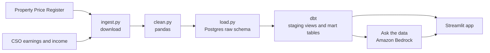

# Irish House Price Pipeline

[](https://github.com/Yurieb/irish-house-price-pipeline/actions/workflows/ci.yml)

An end-to-end data pipeline and web app that answers one question: **where in Ireland can a
young person afford a home?**

**Live app:** https://irish-house-price-pipeline-aebk9dcxyvrcgpijabkrxy.streamlit.app


## Key finding

In 2025 the median home in **Dublin cost 12 times the yearly earnings** of a 25 to 29 year old
(€499,500 against €41,458). In **Longford it was 4.6 times**, the most affordable county.

A first-time buyer earning €45,000 with a €30,000 deposit can borrow enough for a €210,000 home
under Central Bank rules. In the 12 months to 6 November 2026, that bought the median home in
**just 1 of the 26 counties** (Longford, €200,000).

## What the app does

- **Affordability calculator.** Enter your income and deposit to see the most you can borrow,
  your maximum price, and which counties are within budget, on a map and in a table.
- **Price trends since 2010.** Compare up to four counties on median price, price compared with
  earnings, and yearly change.
- **Ask the data.** Type a question in plain English, such as *"Which 5 counties had the biggest
  price rise in 2025?"*, and an AI agent looks up the answer in the database. The table and
  every step it took are shown so they can be checked.

## How it works



| Step | What happens | Tools |
|---|---|---|
| Ingest | Downloads every residential sale since 2010 (774,517 sales) and CSO earnings and household income tables | Python, requests |
| Clean | Parses prices and dates, standardises county names, drops sales not at full market price, writes clean CSVs that pytest checks | pandas, pytest |
| Load | Loads the clean files into a `raw` schema in PostgreSQL | SQLAlchemy |
| Transform | Staging views tidy each source, then four mart tables give median prices, yearly change, affordability ratios and the latest 12 months by county. dbt tests check keys, nulls and accepted values | dbt |
| Serve | The Streamlit app reads only the mart tables, cached for an hour | Streamlit, Altair |

### Deployment and automation

- **Database:** PostgreSQL on **AWS RDS**.
- **App:** **Streamlit Community Cloud**, with credentials stored in Streamlit secrets.
- **CI:** a **GitHub Actions** workflow runs pytest and `dbt parse` on every push.
- **Monthly refresh:** a scheduled GitHub Actions workflow re-runs the whole pipeline against RDS
  on the 1st of each month, so the app stays up to date with no manual work.
- **Docker:** `docker compose up --build` runs the database, the pipeline and the app locally
  with one command.

## Ask the data

Ask the data is an **AI agent**: the model is given a goal and two tools, and it decides which
tool to call, looks at the result, and keeps going until it can answer.

| Tool | What it does |
|---|---|
| `run_sql` | Runs a SELECT on the mart tables and returns the rows |
| `distinct_values` | Lists the values in one column, e.g. how counties are spelled or which years exist |

```
"What was the median price in county Corke last year?"
  step 1  run_sql   select extract(year from current_date) - 1        -> 1 row (2025)
  step 2  run_sql   select median_price ... where county = 'Cork' and year = 2025   -> 1 row
"The median price in county Cork last year was €370,000."
```

If a query is rejected, errors or finds no rows, the agent sees why and tries something else.
It gets at most 6 turns, so it can't loop forever, and **it is never allowed to answer without
data**: if it hasn't run a query that returned rows, the app says it couldn't find the answer.

The model is **Amazon Nova Pro** on **Amazon Bedrock**, chosen because it scored best in the
evaluation below. It is called with tool use through boto3's Converse API, so changing model is
a one-line config change.

**Security comes in layers**, so one mistake can't do damage on its own:

1. **Every query is checked in code.** [`check_sql`](src/ask.py) parses the SQL with sqlglot,
   rather than searching the text. It rejects anything that isn't a single SELECT,
   including writes hidden inside a `WITH`, and any table that isn't one of the four marts.
   `distinct_values` only accepts table and column names that really exist in the marts.
2. **The database user can only read.** `ask_reader` has SELECT on the four mart tables and
   nothing else. It is set to read-only, with a 5 second statement timeout, so even a query that got
   past the check couldn't change data or run for long. A dbt post-hook re-grants access after
   each rebuild.
3. **The AWS key can only call the model.** The app's IAM user has a single permission,
   `bedrock:InvokeModel`.

Answers are cached for an hour so repeat questions cost nothing, and any failure (AI service
down, bad query, timeout) shows a friendly message instead of an error.

### Evaluation

[`src/evaluate_ask.py`](src/evaluate_ask.py) asks 20 questions with known answers. Each right
answer comes from hand-written SQL run on the same database, so the test stays correct after
every refresh.

I measured each version of the feature as I built it:

| Version | Nova Pro | Nova Lite |
|---|---|---|
| Fixed steps: one query, then retry with the error (up to 3 tries) | 20/20 | 19/20 |
| **Agent with tools** (current) | **20/20** | 19/20 |

What the numbers hide:

- **Retrying only helps if the model can use the feedback.** With fixed retries, Nova Lite got
  *"How many homes were sold in Cork in 2024?"* wrong. It used the "last 12 months" table, was
  told it found no rows, and wrote the same query twice more.
- **As an agent, Nova Lite solved the Cork question**, recovering after 4 tool calls, but on a
  different question it tried to answer without running any query. The no-data-no-answer rule
  blocked it, so the app said it couldn't find the answer instead of risking a made-up number.
- **Nova Pro** got 20/20 both ways. As an agent it needed 21 tool calls for 20 questions, and
  recovered by itself once when a query didn't work.

Full results for the latest run are in [docs/ask_evaluation.md](docs/ask_evaluation.md).

The feature also has 39 pytest tests covering the safety checks, the agent loop, recovering from
mistakes and error handling, with Bedrock and the database mocked so they run free in CI.

## Data sources

- [Property Price Register](https://www.propertypriceregister.ie/): every residential property
  sale in Ireland since 2010.
- [CSO PxStat](https://data.cso.ie/): median annual earnings by county and age group (table
  DEA06), and household income by county for 2022 (table GPIIA05).
- [Tailte Éireann county boundaries](https://data-osi.opendata.arcgis.com/datasets/osi::counties-national-statutory-boundaries-2019-generalised-20m):
  the county shapes on the map, used under the
  [CC BY 4.0](https://creativecommons.org/licenses/by/4.0/) licence and simplified to reduce
  file size.

## Mortgage rules

The affordability calculator applies the
[Central Bank of Ireland mortgage measures](https://www.centralbank.ie/financial-system/financial-stability/macro-prudential-policy/mortgage-measures):

- **Loan-to-income limit:** a mortgage of at most 4 times gross annual income for first-time
  buyers, and 3.5 times for second and subsequent buyers.
- **Loan-to-value limit:** a mortgage of at most 90% of the property's value, so a deposit of
  at least 10%.

Lenders may exceed these limits for a share of their lending, which the calculator does not
model. It also leaves out stamp duty, fees and schemes such as Help to Buy.

## Tech stack

Python, pandas, PostgreSQL, SQLAlchemy, dbt, pytest, Streamlit, Altair, Docker,
GitHub Actions, AWS (RDS, Bedrock, IAM), boto3, sqlglot.

## Project structure

```
src/       ingest, clean and load scripts, the ask the data engine and its evaluation
sql/       database schema and the read-only user
dbt/       dbt models: staging views and mart tables, with tests
app/       Streamlit web app
tests/     pytest tests: cleaning, data quality, mortgage rules, ask the data
docs/      screenshot and the evaluation report
data/      raw and cleaned data files (not committed)
.github/   CI and monthly refresh workflows
```

## Run it yourself

Requires Python 3.13 and Docker Desktop.

```powershell
py -3.13 -m venv .venv
.venv\Scripts\Activate.ps1
pip install -r requirements.txt
Copy-Item .env.example .env
```

Then edit `.env` and set your own database password.

### Everything with Docker

With Docker Desktop running and a `.env` file in place:

```powershell
docker compose up --build
```

This starts Postgres, runs the pipeline (download, clean, load, dbt build and tests), then
serves the app at http://localhost:8501. Press Ctrl+C to stop.

### Step by step

```powershell
python src/ingest.py
python src/clean.py
python src/load.py
dbt build --project-dir dbt --profiles-dir dbt
streamlit run app/app.py
```

### Ask the data

This needs an AWS account with a Bedrock model enabled, and the `ASK_POSTGRES_*`, `AWS_*` and
`BEDROCK_MODEL_ID` settings in `.env` (see `.env.example`). Then:

```powershell
python src/create_readonly_user.py        # once, creates the read-only database user
python src/ask.py "Which county had the highest median price in 2025?"
python src/evaluate_ask.py                # the 20-question score
```

### Tests

```powershell
pytest -v
```
